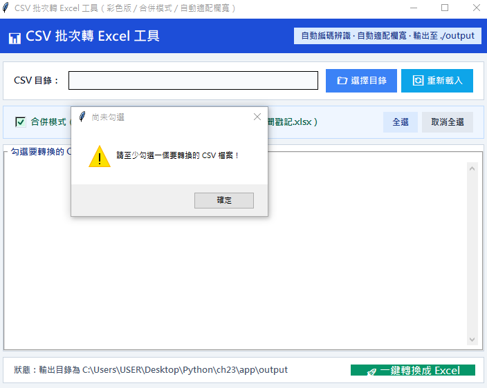

# CSV 批次轉 Excel 工具 (CSV to Excel Batch Converter)

一款基於 Python `tkinter` 打造的輕量化桌面小工具，專為批次處理中文 CSV 資料設計。具備編碼自動容錯、保留前導零（如店號、電話、郵遞區號）、合併分頁匯出與 Excel 欄位寬度自動適配等功能。

---

## 🖥️ 操作畫面



---

## ✨ 核心特色

* **直覺清單勾選介面**：指定來源資料夾後自動列出所有 `.csv` 檔案，支援「全選 / 取消全選」與個別勾選（預設全選）。
* **雙重輸出模式（預設合併模式）**：
  * **合併模式（預設）**：將勾選的多個 CSV 匯出至同一個 `merged_output.xlsx`，**一個 CSV 對應一個獨立工作表（Sheet）**，並自動處理 Excel 分頁名稱 31 字元上限、非法字元替換與重複名稱防呆。
  * **獨立模式**：將勾選的每個 CSV 分別轉存為同名的 `.xlsx` 檔案。
* **資料格式與編碼保護**：
  * 自動相容 `UTF-8-SIG`、`UTF-8`、`CP950`、`Big5` 等常見中文編碼，避免亂碼。
  * 所有欄位預設強制以字串（`str`）讀入並自動去除前後空白，防止店號或電話開頭的 `0` 遺失或轉為科學記號。
* **Excel 自動排版優化**：
  * 自動凍結首列（`A2`），方便捲動檢視大型資料表。
  * 依內容字元長度自動適配欄寬（中文字元以 2 倍寬度計算），避免文字遭到截斷。
* **自動建立輸出目錄**：轉檔結果統一輸出至程式所在目錄底下的 `./output/` 資料夾（若不存在則自動建立）。
* **簡潔易維護架構**：全程式採用純函式（程序化）寫法與集中式色票設定，無複雜類別封裝，方便閱讀與二次修改。

---

## 🛠️ 環境需求與安裝

本工具需使用 **Python 3.8+**，除了 Python 內建的 `tkinter` 外，僅需安裝 `pandas` 與 `openpyxl` 兩個套件：

```bash
pip install pandas openpyxl
```

*(註：Linux 使用者若系統預設未包含 tkinter，請額外執行 `sudo apt-get install python3-tk`)*

---

## 🚀 使用方式

1. **啟動程式**：
   ```bash
   python csv_to_excel_tool.py
   ```
2. **選擇 CSV 目錄**：點擊右上角「**瀏覽目錄**」，選取存放 CSV 檔案的資料夾，清單將自動載入所有 `.csv` 檔案。
3. **選擇輸出模式**：
   * 維持預設的「**合併模式**」（產出 `output/merged_output.xlsx`）。
   * 或切換為「**獨立模式**」（各別產出 `output/<原檔名>.xlsx`）。
4. **勾選目標檔案**：透過勾選框調整要轉換的檔案，或使用「全選 / 取消全選」快速操作。
5. **一鍵轉換**：點擊右下角「**一鍵轉換成 Excel**」，完成後即可在程式同層的 `output/` 資料夾中查看結果。

---

## ⚙️ 自訂與微調說明

程式碼頂部與核心函式皆保留了清晰的參數設定，可依需求直接修改：

| 調整項目 | 程式位置 | 說明 |
| :--- | :--- | :--- |
| **介面配色與字型** | 檔案頂部 `BG_MAIN`、`BG_HEADER`、`BTN_PRIMARY_BG` 等常數 | 集中管理所有十六進位色票與字體大小 |
| **合併輸出檔名** | `start_convert()` 內的 `"merged_output.xlsx"` | 可依需求更改預設合併檔案名稱 |
| **欄寬留白與上限** | `auto_fit_columns(ws, padding=4, max_width=60)` | `padding` 控制額外留白字元數；`max_width` 限制單欄最大寬度 |
| **編碼嘗試順序** | `read_csv_safely()` 內的 `encodings` 清單 | 可增減或調整 CSV 讀取時的編碼偵測順序 |

---

## ⚠️ 注意事項

* **檔案占用問題**：重新執行合併轉換前，請確認 `output/merged_output.xlsx` 未被 Excel 軟體開啟，否則會因 Windows 檔案鎖定機制導致寫入失敗。
* **工作表命名規範**：依據 Excel 官方限制，單一分頁名稱最長為 **31 個字元**，且不可包含 `:`、`\`、`/`、`?`、`*`、`[`、`]`；程式在合併時會自動截斷過長檔名並將非法字元替換為底線 `_`。